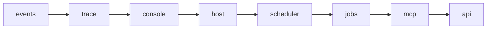

+++
title = "The daemon and the local API"
subtitle = "One process, two loopback ports, three ways in"
lead = "Core runs as one process. It owns the database, the plugins and the job queue. It serves an HTTP API (with MCP on the same port) and a console, each on its own port. The CLI is a client of it. This page covers how it starts and stops, and how it keeps a web page or another program from using it."
badges = [["text-bg-warning", "Alpha"]]
group = "concepts"
order = 27
description = "The core daemon: startup and shutdown order, the runtime file, the API token, the Host, Origin and content-type guards, event streaming, the console listener, and the threat model."
+++

## One process

`oaken_core.daemon` is the composition root. `Core.open()` builds the object graph once: the event
bus, the plugin host and its store (migrations run here), queues, labels, jobs, the agent registry,
the scheduler, the router, intake, the operation registry and the two servers. `Core.start()` then
brings up **units**, in this order:

1. `events`, the event log, so plugin start-up is in the record;
2. `trace`;
3. `console`, before the host, so a plugin that fails to start cannot take it down;
4. `host`, the plugins (their jobs, schedules and MCP exposure are attached here);
5. `scheduler`;
6. `jobs`, the runner;
7. `mcp`, both MCP doors;
8. `api`, last, so nothing is asked of a half-started core.

Stopping runs the other way. The API ends its event streams and stops accepting, the MCP doors
stop, jobs get 30 seconds (`JOB_GRACE`) to finish or hand their leases back, then the scheduler, the
plugins and the store, the console, the trace and the event log. If a unit fails to start, the ones
already up are stopped in reverse and the original error is raised. A failing stop is logged and does
not block the rest. A process that is killed instead is covered by lease expiry, as for any worker
(see [jobs](jobs.md)).



```text
python -m oaken_core.daemon   # the foreground process: Ctrl-C or SIGTERM stops it cleanly
```

The same lifecycle is available to Python in `oaken_core.daemon.lifecycle`: `serve`, `detach`,
`status`, `stop_gracefully` and `reload`. The CLI's `oaken start`, `restart`, `stop` and `reload` are
thin wrappers over them, and they work with no core running. `status` reads only the runtime file, so
it needs no token and never starts anything.

`oaken start` and `oaken restart` run core in the background by default, in a new session with
standard input and output on the null device. `--fg` keeps it attached to the terminal, logging to it.

`oaken stop` sends SIGTERM and waits `--grace` seconds (40 by default: the 30-second job drain and a
margin). If core is still running then, it is killed and its runtime file is removed so the next start
is clean. A killed core loses nothing: its jobs are retried when their leases expire. `--no-kill`
reports an error instead. `oaken restart` takes the same two flags.

### Reload

SIGHUP, `oaken reload` and the `core_reload` operation all ask the running process to rebuild itself
on `config.toml`. The file is validated before anything stops, so a typo changes nothing. A rebuild
keeps the same pid, runtime file and (when the port is `0`) the same ports. If the new core cannot
start, the old settings are put back. An unchanged file is a no-op.

### Who it is: `identity.daemon`

A product built on core calls `oaken_core.identity.configure(app=..., title=..., prog=..., daemon=...)`
once at start. `daemon` is the command that runs that product's core in the foreground. `start` spawns
it as a child, so it must be a program that calls `configure` itself. The default is plain
`python -m oaken_core.daemon`. `app` also names the home folder and its variable (`OAKEN_HOME` for
core, `OAKEN_GROVE_HOME` for an app called `oaken-grove`), so one product never lands in another's
folder.

## Logs

Core logs structured lines to stderr, `console` or `json` by `[log] format`. A detached core has no
stderr, so set `[log] file` to keep its logs: lines are written to that file as JSON **as well as**
stderr. A relative path sits under the data directory. The file is created owner-only (`0600`) and
rotates by size: at `[log] file_max_bytes` it rolls to `.1`, and `[log] file_backups` copies are
kept. A sink that cannot be written never costs the process its log: the write is dropped.
With no file, a table in the core database keeps the lines for `[log] keep_days`. `[log] level` and
`[log] levels` (per logger) apply to every sink, and a reload picks up a change at once. Secrets are
redacted and long values cut at 200 characters before a line is rendered. `[log] events_file`
(default `events.jsonl`) records every bus event, one JSON line each.

## Finding it: the runtime file

While core runs, `runtime.json` in the runtime directory holds `pid`, `host`, `port`, `console_port`,
`version` and `started_at`. It is created owner-only (`0600`) and it is the single-instance lock: it is
created exclusively, with port 0 meaning "starting", before anything is opened. If it exists and its
process is alive, the second start stops with "core is already running". If that process is gone the
file is stale and is replaced. A clean shutdown removes it, and only the process that wrote it removes
it. The port is filled in once both servers are listening, by writing a sibling file and renaming it,
so a reader never sees half a file.

The API port defaults to `0`: the kernel picks one and the runtime file says which. Pin it with
`[api] port`. A reload keeps the port that was in use. If a pinned port is taken, core refuses to
start and says why. The CLI finds core only through the runtime file (or `--url` and `--token-file`
for a server started by hand), so with no file the answer is "core is not running" (exit 3).

## The token

On first start core makes a random 256-bit token and stores it as `api_token` in the config
directory, mode `0600`. A token file others can read is tightened to `0600` and used. Every request
but one needs `Authorization: Bearer <token>`. Both sides are hashed, then compared in constant time.
`GET /v1/health` is open and answers `{"status": "ok"}`, nothing more.

The person's MCP door has its own token (`mcp_token`, same rules). Agents have tokens of their own
(`oaken_agent_...`, made by `agent_create`) that open only `/v1/agent/` and `/mcp/agent`. See
[the swarm](swarm.md). A token is checked only against the surface its path is on, so a token for one
is worthless on another.

## What a request passes through

A browser can send a request to `127.0.0.1:PORT` from any page the user has open, so being on
loopback is not protection. One guard wraps every route and checks, in this order:

| Check | Refusal | Stops |
|---|---|---|
| `Host` is `127.0.0.1:<port>` or `localhost:<port>` (plus `[api] allowed_hosts`, the bind host and any `*.localhost` name a plugin adds) | 400 | DNS rebinding |
| A preflight is answered only for the one `[api] dev_origin`; otherwise no CORS headers | none | a page reading responses |
| A mutating request with a foreign `Origin` or `Sec-Fetch-Site: cross-site` | 403 | cross-site request forgery, even with a leaked token |
| A mutating request has `Content-Type: application/json` | 415 | form and `text/plain` posts a page can send without a preflight |
| A bearer token for the surface being addressed | 401 | another process or page without the token |
| A per-client token bucket on mutating requests (`[api] rate_limit_per_minute`, 600) | 429 | a loop, a runaway agent |
| Body size (`[api] max_body_bytes`, 1 MB) | 413 | memory exhaustion |
| Concurrent requests per surface (64 general, 16 agent, `[api] mcp_max_concurrent` for MCP) | 429 | one door starving another |

The event stream is long-lived, so it holds no concurrency slot. Responses carry
`X-Content-Type-Options: nosniff`, `Referrer-Policy: no-referrer`, `Cross-Origin-Resource-Policy:
same-origin`, `X-Frame-Options: DENY` and, on `/v1/`, `Cache-Control: no-store`. The server's access
log is off, because a URL can hold a search. Errors are one JSON body, `{"code", "message"}`. Anything
unplanned is `internal` (500) and is logged by type only, because its text could quote private data.

## Who is calling

The registry has a caller class, which decides whether a person's `confirm` is accepted (see
[operations](operations.md)). Over HTTP:

- a request is `cli` unless it says otherwise;
- `X-Oaken-Client: ui` is a browser UI, the same privileges;
- `X-Oaken-Client: mcp` makes the request an agent's: it cannot confirm by saying so, only with the
  token from its own proposal, and operations closed to MCP are hidden and refused;
- anything else, including `internal`, is a 400. A header can lower privilege and never raise it.

The MCP server mounts at `/mcp` on the API listener as its own surface, with its own token and limits
(`[api] mcp_max_body_bytes`, `mcp_max_concurrent`), and the mount, not a header, sets its class
([ADR 0004](repo:docs/origin/0004-mcp-server-in-core.md)). It is on unless `[api] mcp_enabled = false`
(or the `mcp_power` operation turns it off); then it answers 503. A second door at `/mcp/agent` takes
agent tokens and offers the job tools plus what the agent was granted. With the swarm off, no agent
token is accepted. A door is exactly its own path.

## The routes

Operations are not routed by hand. `GET /v1/operations` lists the registry, with JSON Schemas, as the
caller may see it. `POST /v1/operations/{name}` calls one through the same client the CLI uses. The
OpenAPI document is served at `/v1/openapi.json`. Everything else is small:

- `GET /v1/events`: server-sent events. Each has an id, a type (the event's class name) and a JSON
  body of ids and numbers, never private text. Send `Last-Event-ID` to resume from the in-memory ring
  (`[api] event_ring_size`, 1000). An id older than the ring, or from before core restarted, gets a
  `gap` event, which means "fetch again". A quiet stream sends a `: heartbeat` comment every
  `[api] heartbeat_seconds` (15).
- `GET /v1/trace/stream`: the trace as it happens, filtered by `plugin`, `job_id`, `subject` or `kind`.
  The trace holds private text, so this route needs the token like any other.
- `/v1/agent/jobs/claim` and `/v1/agent/jobs/{id}/heartbeat`, `complete` and `fail`: the swarm's
  protocol.

## The console

The console is a second listener, always on `127.0.0.1`. It has no host setting, and the settings
model refuses extra keys, so nothing in `config.toml` can widen the bind. Its port is
`[console] port` (62536 by default, `0` for any free one). It has no login. Its guard asks only that
the request really is from this machine and from the console's own pages:

- the TCP peer must be loopback (403 otherwise);
- `Host` must be `127.0.0.1` or `localhost` with the console's port (or a `*.localhost` name a plugin
  adds, which a browser resolves to this machine and cannot be rebound);
- a form post needs a same-origin `Origin` (or `null`, which browsers send on a same-site form) and no
  `Sec-Fetch-Site: cross-site`, or it is 403;
- a post must be a form (`application/x-www-form-urlencoded`, 415 otherwise) under 256 KB;
- every response carries a Content-Security-Policy with no script at all, so a console page cannot run
  one.

The console is core's own: no plugin can switch it off, and it starts before the plugins so a broken
plugin cannot take it down.

## Threat model

| Attacker | Vector | Mitigation | Test |
|---|---|---|---|
| A web page the user visits | `fetch` to `127.0.0.1:PORT` | No CORS headers, so it cannot read a response; JSON-only `POST`; Origin and `Sec-Fetch-Site` refused; the token is not in the page's reach | `test_a_cross_origin_post_is_refused_even_with_the_token` |
| A web page, by DNS rebinding | A name that resolves to 127.0.0.1 | Host allowlist, checked first | `test_a_wrong_host_is_refused_before_anything_else` |
| A web page, by a plain form | `text/plain` or form `POST` | 415, and Origin refused | `test_a_post_must_be_json` |
| Another machine | Connecting to the port | Binds `127.0.0.1`; another host needs `remote_ok = true`, said on purpose, and then the token is the only gate. The console cannot leave loopback at all | `test_a_non_loopback_bind_needs_remote_ok`, `test_the_console_listens_on_loopback_only_and_nothing_can_change_that` |
| Another local user | Reading the token or runtime file | Both `0600` from creation | `test_the_token_file_is_private_and_a_loose_one_is_tightened`, `test_the_file_is_private_from_the_first_byte_and_after_publish` |
| Anything on the machine without the token | Guessing it | 256 random bits; constant-time compare; the rate limit | `test_the_token_is_compared_in_constant_time` |
| A compromised or confused agent | Using its token on the general API | Agent tokens open `/v1/agent/` and `/mcp/agent` only, and the API token opens no agent route | `test_an_agent_token_opens_the_job_routes_and_nothing_else`, `test_each_mcp_door_takes_only_its_own_token` |
| An MCP client | Claiming to be a person | `X-Oaken-Client: mcp` only lowers; a confirmation token is bound to the caller it was given to | `test_an_mcp_caller_can_only_confirm_with_the_token_its_own_proposal_produced` |
| An agent | Revoked but still holding a lease | The lease goes back to the queue; its next call is refused | `test_a_revoked_agent_token_stops_working` |
| A caller | Huge bodies, floods, many parallel calls | Size, rate and concurrency limits per surface | `test_a_body_over_the_limit_is_refused`, `test_mutating_requests_are_rate_limited_per_client` |
| A second core | Starting on the same data | Runtime file as an exclusive lock | `test_a_second_instance_is_refused_while_the_first_lives` |
| A crash | A stale runtime file | Replaced when its pid is gone | `test_a_stale_file_is_replaced` |
| A log reader | Private text in logs or events | Secrets redacted, long values cut, events carry ids only, requests are not logged | none yet |

Not covered: a process running as the same user can read the token file and do what the user can. The
change log records what it did.

## Not built yet

- The ring is in memory: a restart is a `gap` for every client.
- Per-agent rate limits beyond the lease and hourly quotas in [the swarm](swarm.md).
