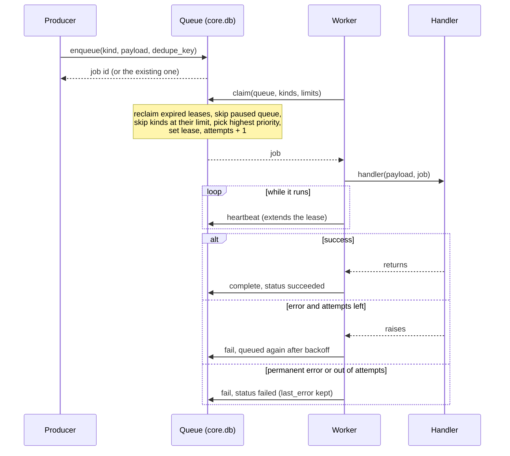

+++
title = "Events, jobs and the scheduler"
subtitle = "How core does work in the background"
lead = "An in-memory event bus says what happened. A durable job queue does the work and survives a crash. A scheduler puts recurring work on that queue."
badges = [["text-bg-warning", "Alpha"]]
group = "concepts"
order = 20
description = "The event bus and logs, the durable job queues with leases and retries, queue pause, and the scheduler."
+++

## The pieces

| Piece | Lives in | Survives a restart? | Job |
|---|---|---|---|
| Event bus | memory | no | tell listeners that something happened |
| Event log | `events.jsonl` | yes | keep what the bus said |
| Job queues | `core.db` | yes | run work at least once, with retries |
| Scheduler | `core.db` | yes | enqueue recurring work on time, once |

## Queues

A queue is a named lane of jobs. `default` always exists and cannot be removed. Intake formatting
runs there. `store` and `embed` are hidden stages core runs for you (the ingestor and the
embedder do their work). You make more in `config.toml` as `[queues.<name>]`, each the stage of
one analyzer kind. Names match `[a-z][a-z0-9_-]{0,40}`. Each queue has a worker count (default
one; `default` gets two). See `repo:src/oaken_core/queues.py`.

A job never picks its queue. It goes where its subject's `queue` label says, or to `default`. A
label change does not move jobs already queued: use `requeue` with a target queue.

**Pause.** `oaken queue pause NAME` stops a queue handing out jobs. Running jobs finish. The switch
is a row in `queue_state`, so it survives a restart. `oaken queue resume NAME` undoes it. Pausing is
how you free a GPU or stop a stage while you fix a plugin. Each change is published as a
`QueueStateChanged` event. A paused queue still hands out jobs at `PRIORITY_USER` (100) or above: a user's own
request (such as `item_rerun`, which defaults to that priority) runs next, even with the queue closed. Everything
else waits for the resume.

## The job lifecycle

A job is a row in `core.db`. A worker *claims* it: one short transaction marks the best runnable
job `running` and gives the worker a **lease**. A worker that dies stops renewing its lease. When
the lease expires, the job is queued again.

States are `queued`, `running`, `succeeded`, `failed` and `cancelled`. Every change is published
as a `JobStateChanged` event.

## Numbers

All from `[jobs]` in `config.toml` unless noted.

| Setting | Default | Meaning |
|---|---|---|
| `lease_seconds` | 60 | How long a worker holds a job before it must heartbeat |
| `max_attempts` | 3 | Tries before a job is `failed` |
| `backoff_base_seconds` | 5 | Delay after the first failure |
| `backoff_max_seconds` | 900 | Cap on the delay |
| `backoff_jitter` | 0.2 | Fraction taken off the delay, at random |
| `handler_timeout_seconds` | 600 | A handler that runs longer fails. 0 turns it off |
| `max_result_bytes` | 65536 | Cap on a stored result |
| `requeue_cooldown_seconds` | 60 | Per job, between requeues |
| `kind_limits` | none | Concurrency cap per job kind |

Priority is a number, higher first: user 100, ingest 50 (the default), backfill 10. Within a
priority, the job that became runnable first goes first.

## Guarantees and rules

- **At least once.** If a worker dies mid-job, the job runs again after its lease expires, so
  handlers must be idempotent. A worker that lost its lease cannot mark the job done: the finish
  is fenced by the worker's id.
- **Dedupe.** An `enqueue` with a `dedupe_key` that is already queued or running adds nothing and
  returns the existing job. When the job finishes the key is free again.
- **Retries.** After the Nth failed attempt a job waits `min(backoff_max, backoff_base * 2^(N-1))`
  seconds, less up to `backoff_jitter` at random. A handler can raise `PermanentJobError` to fail
  at once. A payload that does not validate, or a result that fails its schema, fails at once too.
- **Deferral.** A handler can raise `Deferred`. The job goes back for the time it names and the
  attempt is not counted: it is waiting, not failing. The embed stage does this while no embedder
  is healthy.
- **Errors are stored safely.** `last_error` has secrets redacted and is cut to 500 characters.
- **Per-kind concurrency.** A handler may declare a cap (one `embed` job at a time on one GPU).
  `[jobs] kind_limits` wins. The cap is enforced in the claim, so it holds across all workers.
- **Cancellation.** A queued job is cancelled at once. A running job is asked to stop: its handler
  task is cancelled, so handlers should be cancel-safe.
- **Shutdown.** `stop()` gives in-flight jobs a grace period (30 seconds), then cancels them and
  releases their leases without counting the attempt.
- **Long jobs.** A running job renews its lease every third of the lease length.
- **Requeue.** `oaken queue requeue` puts failed, cancelled or queued jobs back to run now, with
  attempts reset. It can move them to another queue. For intake jobs, `retriage` clears the machine
  labels so triage decides again (the human layer stays). Each requeue writes a change-log row.

## Events

The bus carries typed, frozen events: job state changes, queue pause changes, plugin health,
events a plugin defines itself, and two private kinds (log lines and the trace). Two kinds of
listener:

- **Handlers** are internal components. Every matching event reaches every handler. A handler that
  raises is logged and skipped. It cannot hurt anyone else.
- **Streams** feed clients (the `/v1/events` endpoint, `oaken watch`). Each has a bounded queue
  (256 by default). If a consumer falls behind, the **oldest** events are dropped and counted. A
  slow stream never blocks the publisher. Log and trace events reach a stream only when asked for.

The API keeps the last `[api] event_ring_size` events (1000) for a client that reconnects.

## The event log

The bus forgets on restart. The **event log** is one more handler that appends every event to
`events.jsonl` in the data directory (`[log] events_file`; empty turns it off). A line is
`{"ts", "kind", "data"}`. Data holds ids, states and numbers, never private text. The file is
owner-only and rotates by size (`[log] file_max_bytes`, `file_backups`). `oaken events tail` reads the
newest lines back. See `repo:src/oaken_core/eventlog.py`.

Log lines have their own home: the `log_lines` table, pruned after `[log] keep_days` (7), or the
`[log] file` if you set one.

## The trace

The trace records what a model or agent is told, and what it returns, in full text. It is for a
person tuning triage. Because it holds private text it is **off by default**, goes to its own
owner-only file (`trace.jsonl`, rotated like the event log), is never offered over MCP, and is
read only through the authenticated API (`/v1/trace/stream`). Each row carries the plugin and job
it ran under, so you can follow one job. See `repo:src/oaken_core/trace.py`.

## Results, parents and actors

A job can store a **result**, checked against a schema for its kind before it is saved. It can
name a **parent** job. It records its **actor** (user, agent or system). External agents can lease
jobs too: see [the swarm](swarm.md).

## The scheduler

A schedule is a fixed interval or a five-field cron expression. It stores its `next_run` in
`core.db`. A tick enqueues every due schedule and moves `next_run` forward in one transaction, so
a restart neither repeats a run nor skips one. The job also carries a dedupe key naming the slot,
as a second guard. Each schedule names a queue, a kind, a payload and a priority (default 50).

- **UTC only.** Cron fields are read in UTC. The parser can take a time zone, but the scheduler
  does not pass one, so there is no time zone setting today.
- **No catch-up storm.** If the process was down for several periods, the missed runs collapse
  into one run on the next tick. Then the normal rhythm resumes. Intervals keep their phase
  (anchor plus a whole number of periods).
- **Run now.** `oaken schedule run` enqueues one run and leaves `next_run` alone.
- **Idempotent.** Adding a schedule at every start is safe. An unchanged one keeps its `next_run`.
  A changed one recomputes it. A plugin's own schedule comes back at the next start.

The cron parser has no dependency. It covers `*`, numbers, ranges, lists, steps and three-letter
month and weekday names (weekday 0 and 7 are Sunday). If both day-of-month and day-of-week are
restricted, either may match, as in classic cron. There is no `@daily` and no seconds field. See
`repo:src/oaken_core/cron.py` and `repo:src/oaken_core/scheduler.py`.

## Testing

Everything above runs against a fake clock with no sleeping: advance the clock, call `drain()` on
the runner or `tick()` on the scheduler, and look at the database.
