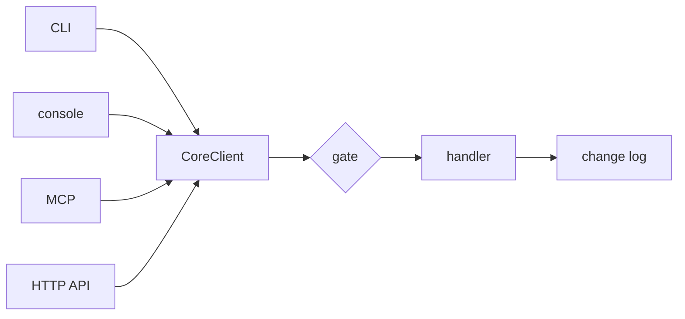

+++
title = "Operations"
subtitle = "Every capability is one typed operation, with a permission class and a confirm gate"
lead = "The CLI, the console and the MCP server do not each decide what is safe. They all call one registry of typed operations, and the rules live in code: a permission class on every operation, a confirm gate on every change, and a ceiling on what an agent may ever be offered."
badges = [["text-bg-warning", "Alpha"]]
group = "concepts"
order = 50
description = "The operation registry, permission classes, the confirm gate and proposals, MCP exposure you control, plugin operations, the OpenAPI document and the CLI exit codes."
+++

## One registry, four doors

An operation has a name, a one-line summary, input and output models (pydantic), a permission class
and a handler. `GET /v1/operations` lists them with their JSON Schemas. The OpenAPI 3.1 document at
`/v1/openapi.json` is derived from the same models, so it cannot disagree with the code. Each
operation is `POST /v1/operations/<name>`, and there is no route written by hand for any of them.



A caller says which door it came through: `cli`, `ui`, `mcp` or `internal`. The transport sets that,
never the caller. An `mcp` caller is always an agent, and a `cli` or `ui` caller always acts for the
user. Only a person can confirm.

Core operations are plain names (`queue_list`, `label_set`). A name has a group: `queue_requeue` is
`queue requeue` on the CLI, and the group must prefix the name. A plugin's operations are
`<plugin>.<name>` and sit under the plugin on the CLI.

## Permission classes

| Class | Meaning |
|---|---|
| `read` | Changes nothing. |
| `mutate` | Changes something. Needs confirming. |
| `send` | Reserved. Refused in this version, and never offered over MCP. |

Defining an operation that breaks a rule fails at import, so it cannot ship: a bad name, a `send` that
could be offered over MCP, a `mutate` an agent can reach that has no preview (it could not say what it
would change), or a plugin operation that starts `on` over MCP.

## The confirm gate

Every call goes through `CoreClient.call`, in this order:

1. **Exposure.** An MCP caller gets "not available" for anything not offered to it, in the same words
   whether it is switched off, can never be offered, or this agent was not granted it.
2. **Input.** It must parse. The error names the field, never the value.
3. **Class.** `send` is refused.
4. **Confirmation, for `mutate`.**
   - A person at the CLI or console confirms by passing `confirm` (`--yes` on the CLI), meaning they
     asked for exactly this.
   - An agent cannot. It gets a **proposal**: a summary, what would change (ids with before and
     after), a count, and a single-use `confirmation_token`. Nothing has changed yet. It calls again
     with the token, which is accepted only for the same operation, the same input (by hash) and the
     same caller (class, actor and agent id).
5. **Run, validate the output, audit.**

Tokens are random, kept in memory only (a restart forgets them, which is the safe direction), and
stored as a hash. They last `[operations] confirm_ttl_seconds` (300 by default) and are burned by any
attempt to use them, right or wrong. A caller can hold at most `max_pending_confirmations` (64) at
once. A proposal lists at most `proposal_changes_shown` (20) changes and always carries the true
count.

The audit row is a change-log entry, `call:<operation>`, naming the door and the agent if any. It holds
a hash of the input, never the input, because an input can hold what a person typed. The registry
writes it for a confirmed `mutate`, and for any operation declared `audit="always"` (the agent job
protocol, so what an agent did is on the record).

## What an agent is offered

Each operation has a **ceiling** fixed in code: `never`, `off` or `on`.

- `never`: cannot be offered over MCP, whatever you set. Managing agents, editing exposure itself,
  the `mcp_power` switch and similar are `never`.
- `off`: may be offered, and is not until you turn it on.
- `on`: offered by default.

You can lower an operation, or a whole plugin, from the default, and raise one up to its ceiling.
Exposure rows live in the database (`operation_settings`) and change through `exposure_set`, which is
`never` itself, so an agent cannot widen its own reach. Every change is logged. In `config.toml`:

```toml
[mcp.allowed]
status = true
my_plugin = false     # a plugin name turns all of its operations on or off

[operations]
lift_never = []       # operations whose `never` ceiling this file lifts, by name
```

The `[mcp.allowed]` table is the source of truth for its own rows: they are rewritten on every start,
and a key removed from the file drops its row. An unknown name, or a `never` operation, is warned about
and skipped, so a typo in a headless file does not stop startup. `lift_never` is the one way past a
ceiling. It lowers `never` to `off` (still off until turned on), only someone who can edit the file can
do it, and no operation can.

An **agent** on `/mcp/agent` is also bound by what it was granted. It may call the job protocol
(`job_claim`, `job_heartbeat`, `job_complete`, `job_fail`; see [the swarm](swarm.md)) with no grant,
because its token's own scope bounds it. Anything else needs a grant by name or by `plugin:<name>`, and
the ceiling stays above any grant. A revoke or a changed grant applies at once.

The person's MCP door also has a master switch, `[api] mcp_enabled`. Results over MCP are cut at
`[api] mcp_max_result_bytes` (256000), and a result that holds outside text is fenced as data.

## Plugin operations

A plugin can offer operations, named `<plugin>.<name>`. They get the same gate, the same audit and
the same ceiling rules, with these differences:

- they start **off** over MCP (a plugin cannot declare itself `on`);
- the handler gets the context the plugin host builds for it, not the database;
- a failure inside a plugin is reduced to its type, because it could quote private text;
- a call has a timeout, and a plugin that is not healthy offers nothing.

Plugin operations are looked up live, so one that goes unhealthy drops out and returns with the plugin.
See [plugins](../plugins.md).

## CLI exit codes

The exit codes are a stable contract a script can rely on. They live in one place,
`repo:src/oaken_core/cli/exits.py`, and map core's machine `code` onto a number.

| Code | Meaning |
|---|---|
| 0 | ok |
| 1 | error: the operation ran and failed, or an unexpected error |
| 2 | usage: bad arguments or input (`invalid_input`) |
| 3 | core is not running (also an `unavailable` error) |
| 4 | authentication: the API token was refused (`auth_required`) |
| 5 | needs confirmation: a mutation returned a proposal and was not confirmed (`confirmation_invalid` maps here too) |

A mutation without `--yes` prints what would change and exits 5. Any other code is exit 1.

## Not built yet

- Confirmation tokens are in memory. They do not survive a restart, and there is no shared store.
- `send` is a reserved class with no operation behind it.
