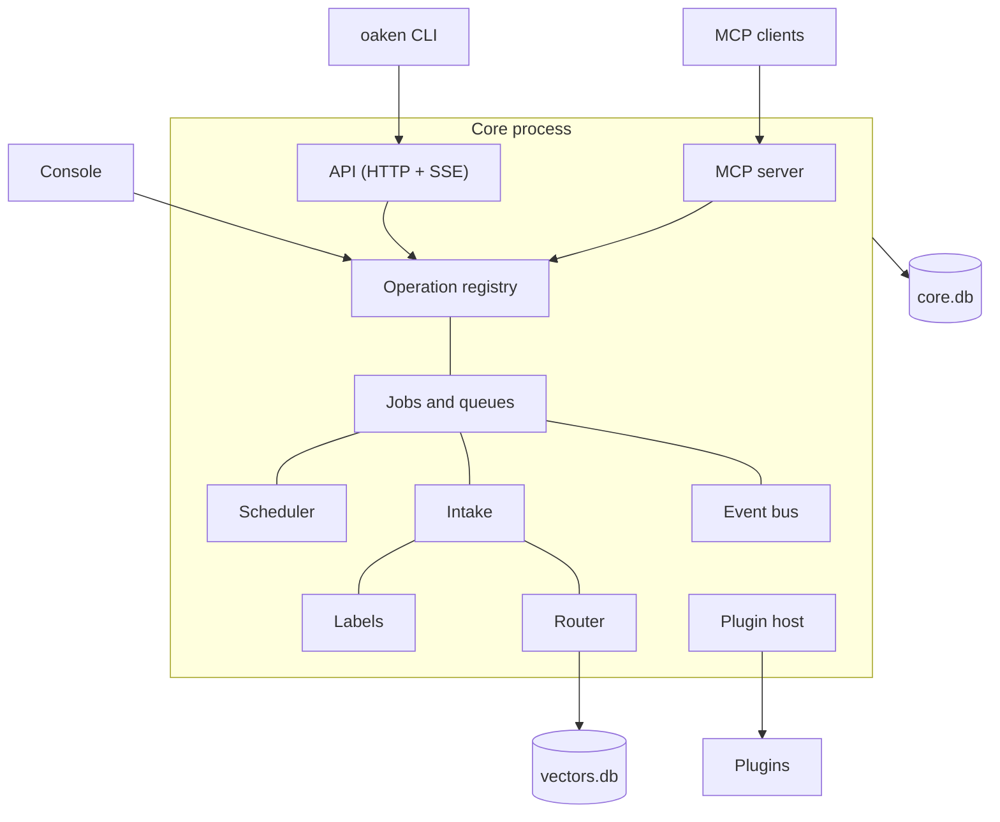
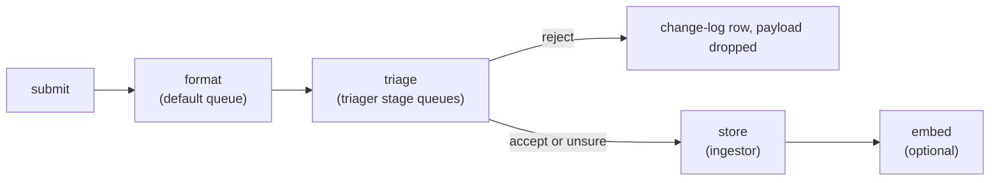

+++
title = "Architecture overview"
subtitle = "How Oaken Core fits together"
lead = "One long-running process runs an async pipeline and loads plugins. It has no nouns. A product says what an item is. Everything you touch is a door into the same operations."
badges = [["text-bg-warning", "Alpha"]]
group = "concepts"
order = 10
description = "Intake, labels, queues, jobs, the router, the four doors, the plugin kinds and the databases."
+++

## The shape of the system

Core is a pipeline and a plugin loader. It carries **items** (any payload) from a source to a
store. It never learns what an item is. A product supplies that through plugins.

One process does the work. It offers four doors over the same operation registry.

| Door | What it is | Notes |
|---|---|---|
| CLI | `oaken` | A thin client of the API, or in process |
| API | `/v1/*` over HTTP, with server-sent events | Token protected. Binds `127.0.0.1` unless `[api] remote_ok` |
| MCP | `/mcp`, `/mcp/agent` | Data-only. Agent tokens are the machine credential |
| Console | a small local web page | Always `127.0.0.1`, port 62536 by default. No setting can widen it |

Every operation is defined once, with a permission class. The API, the CLI and MCP are generated
from that registry, so they cannot drift apart. See [operations](operations.md) and
[ADR 0004](repo:docs/origin/0004-mcp-server-in-core.md).

## Intake

An item enters with `oaken intake submit` (or a provider plugin calling `submit`). Triage runs
**before** anything is stored. Each step is a durable job.

1. **Submit.** The item gets a provisional subject id. Labels set at submit land on it. Nothing is
   stored.
2. **Format.** A formatter plugin, picked by the item's `format`, splits the body into named
   **parts** (in memory). With no formatter, the body is one part, `body`. A dict body counts as
   `json`. A format nobody handles, or one that fails to parse, goes on whole by default. Set
   `[jobs] unmatched_format` or `failed_format` to `fail` to hold it instead.
3. **Triage.** Triagers (lowest `rank` first) look at the parts and give a verdict: accept,
   reject or unsure. Any reject ends the round. They write labels, including `queue` and
   `priority`. With several triager stages, an item passes through them one after another.
4. **Store.** The ingestor plugin stores the item and returns its real subject id. The labels move
   to it. One change-log row records it.
5. **Embed.** If the router is on and the item is labelled `embed` (or `[jobs] embed_by_default`),
   its vector is filed in the vector store.

A reject stores nothing. It writes one content-free change-log row (time, source, verdict, reason,
a hash of the payload) and clears the labels. The `store` label (true or false) overrides this per
item; without it `[jobs] store_by_default` (on) decides for a pass.

A failing triager backs intake up. The job retries, then stays failed with its payload kept, and
`requeue` replays it once the triager is fixed. Core never purges intake.

Plain `oaken` ships a fallback ingestor that keeps `(subject, source, body, parts)` rows, so
`oaken items list` has something to show. A product's own ingestor replaces it.

## Labels

A label is a key and a value on a subject. Each key has two layers: **human** and **machine**. The
effective value is the human one if set, else the machine one. A re-run of a model cannot overwrite
a person's decision. Keys are registered first. Core reserves `queue`, `priority` and
`confidential`. Every write names its actor and goes in the change log.

## Queues, jobs and the scheduler

Jobs live in named queues. `default` always exists (intake and formatting run there). `store` and
`embed` are hidden stages core runs for you. You add more in `config.toml` (`[queues.<name>]`),
each the stage of one analyzer kind (triager, enricher, action). A job never picks its queue: the
subject's `queue` label does. Details are in [events, jobs and the scheduler](jobs.md).

## The router

The router decides the cheapest way to answer a model call, and counts it. An analyzer asks it; it
picks a backend and keeps an answer cache and a usage ledger. See [the router](router.md). Text
that reaches a model is marked untrusted: see [prompt safety](prompt-safety.md).

## Plugin kinds

Plugins extend core through declared kinds. The list is open: a product registers its own with
`KindRegistry.register`. Core ships these (from `repo:src/oaken_core/plugins/kinds.py`).

| Kind | Job | Notes |
|---|---|---|
| `store` | Opens the database | One active. Starts first. SQLite ships |
| `auth` | Authenticates and authorizes | One active |
| `gateway` | Serves a protocol | |
| `provider` | Brings items in | |
| `ingestor` | Stores an accepted item | One active. A product supplies it |
| `formatter` | Splits an item into parts | Chosen by `format` |
| `llm_backend` | Runs a language model | |
| `embedder` | Turns text into vectors | |
| `vector_store` | Stores and searches vectors | sqlite-vec ships |
| `cache_store` | Keeps cached answers | |
| `triager` | Judges an item before storage | Analyzer |
| `enricher` | Derives data from an item | Analyzer |
| `action` | Does something about an item | Analyzer |

Analyzer kinds each get a queue stage and take part in the `needs` graph. Plugins are Python entry
points. See [Writing a plugin](../plugins.md). The core never imports product code, and a plugin
meets core only through its contract.

## Databases

Storage is local SQLite by default. The `store` plugin hands core a database with one writer and a
pool of readers (WAL). Core applies its migrations on open and nothing else opens a database.

| File | Contents |
|---|---|
| `core.db` | Change log (append-only), labels, jobs, queue pause state, schedules, agents, operation settings, answer cache, model ledger and spend, the log table |
| `core.db` (plugin tables) | A plugin that sets `migrations_dir` gets its own tables here: the fallback ingestor's `items_rows`, the dedupe triager's `dedupe_seen` |
| `vectors.db` | The vector collections of the sqlite-vec store |
| `events.jsonl`, `trace.jsonl` | Event log and trace, as rotated files |

All sit under the data directory unless a setting moves them. There is no derived index database:
core keeps no copy of an item beyond what the ingestor stores. A store plugin can replace SQLite,
but the contract is SQL.

## Principles

- **No nouns.** Core carries parts and labels. Plugins give them meaning.
- **Triage before store.** What is stored is up to the labels.
- **At least once.** Jobs may run twice, so handlers are idempotent.
- **Local first.** The console and, by default, the API bind loopback.
- **Text is data.** Item text reaches a model only as marked untrusted input.
