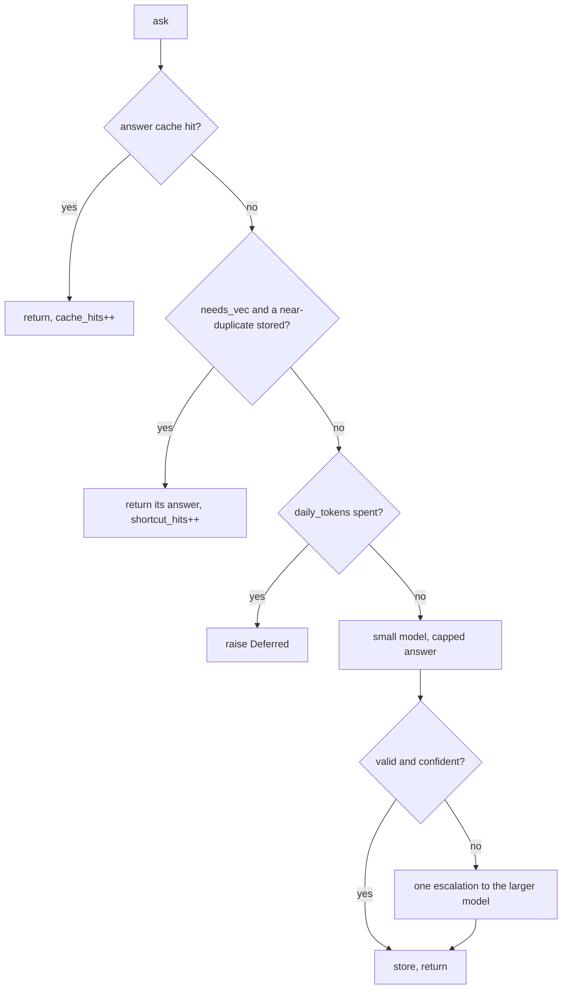

+++
title = "The model router"
subtitle = "The cheapest honest way to answer"
lead = "A plugin asks the router a question. The router tries the cache, then a near-duplicate's answer, then a small model with a capped answer, then one larger model. Every rung is counted."
badges = [["text-bg-warning", "Alpha"]]
group = "concepts"
order = 36
description = "The router ladder (cache, near-duplicate shortcut, capped small model, one escalation), backends and routes, the cache key, the ledger, the daily token budget and Deferred."
+++

## The ladder

`Router.ask(route, call, request, output)` in `repo:src/oaken_core/router/router.py` returns a
validated answer. A plugin reaches it through `BaseLLMAnalyzer.ask()`. Cheapest rung first:



The plugin's own rules come before all of this (they are not in the router). The rungs:

1. **Cache.** Looks up the answer for this exact question (below). Also tries the escalation model's
   key. A hit costs no model call. A stored answer that no longer fits the schema is ignored.
2. **Near-duplicate shortcut.** Only for a plugin that sets `needs_vec` (`BaseVecAnalyzer`) and passes
   `text`. The router embeds the text and asks the vector store for the nearest stored question. If
   its score is at least `[router] near_duplicate_score` (0.97) and its answer is still cached, that
   answer is returned. Off when `[router] shortcuts = false`.
3. **Small model, capped.** The first backend of the route that is healthy and allowed (the route's
   own, then its `fallback` list in order). The answer is capped at `max_output_tokens` (default
   `[router] default_output_tokens`, 256). Input is cut to fit the context window. A call that
   takes more than `call_timeout_seconds` (120) counts as a backend failure, and the next fallback is tried.
4. **One escalation.** If the answer is invalid, or has a `confidence` field below
   `[router] min_confidence` (0.6), the router asks the route's `escalate` backend and model once. No
   second retry. If nothing larger may answer, a low-confidence answer is kept, and an invalid one raises
   `AIBackendError`. An escalated answer that is invalid raises it too, and nothing is stored.

Only an answer that stands is stored.

## Backends and routes

A backend is a plugin of kind `llm_backend`. Each instance is a table
`[plugins.llm_backend.<name>]` with `plugin`, `locality` and `concurrency`. `locality` is `local`,
`lan` or `hosted`; unset means `hosted`. `concurrency` (default 1) is the size of that backend's own
semaphore. It is read when the backend is first used, so a change needs a restart.

A plugin names what it wants in `route`, as a default dict on the class. The owner overrides it in
`[plugins.<kind>.<name>.route]`:

```toml
[plugins.triager.llm.route]
backend = "desk"
model = "qwen3"          # empty: the backend's own default
fallback = ["laptop"]    # tried in order if the backend errors
min_confidence = 0.7     # overrides [router] min_confidence
daily_tokens = 200000    # 0 (the default): no budget
escalate = { backend = "big", model = "qwen3-72b" }
```

Who may answer a confidential item is in [prompt safety](prompt-safety.md).

## The cache key

The key is **(analyzer, version, content hash, model)**, the model being the one that answers (the
route's, else the backend's default). The table is `answer_cache` in core's database. Each part earns
its place:

- `version` is the plugin's `version`. Bump it when the prompt or the answer could change, and old
  answers stop matching.
- `content hash` names what the answer is about. The plugin supplies it. Anything that changes the
  answer (the llm triager's criteria, for one) belongs in it.
- `model` keeps two models from sharing an answer.

A `cache_store` plugin may replace the table. Name it in `[router] cache_store`. It must provide
`key`, `get`, `put`, `stats` and `clear`. While it is unhealthy, core's own table is used.
`cache_clear` deletes cached answers.

## The ledger

Every rung writes counters to `llm_ledger`, one row per (analyzer, model, backend):

| Column | Counts |
| --- | --- |
| `calls`, `tokens_in`, `tokens_out` | Model calls that ran, and their tokens (the backend's count, else length / 4). |
| `cache_hits`, `shortcut_hits` | Questions answered without a model. |
| `escalations` | Times the larger model was asked. |
| `tokens_saved` | For a hit, what the stored answer cost to make (in plus out). |

The ledger never holds text. The operation `ai_usage` (not offered over MCP) reports it, with totals
for calls, tokens spent, tokens saved and answers made without a model.

`tokens_saved` is an estimate of calls skipped. It is not a bill, and it says nothing about what a
client would have read.

## The daily budget

`daily_tokens` on a route caps what one analyzer may spend in a UTC day. Spend is kept in `llm_spend`
(tokens and deferrals per analyzer per day), and `ai_usage` shows it as `spent_today`. Once spend
reaches the cap:

- Cache and shortcut hits stay free.
- A model call is not made. The router raises `Deferred`.
- An escalation is skipped, and the small model's answer stands.

The check happens before a call, so one call may carry spend a little past the cap.

## Deferred

`Deferred` is "not now, and not a failure". The job returns to the queue after `retry_after` seconds
(see [jobs](jobs.md)), and the attempt is not counted. The router raises it when the budget is spent
(retry at the next UTC midnight) and when a `needs_vec` call finds no healthy embedder or vector
store (retry after `[router] wait_seconds`, 30). A backend that is down raises `Unavailable` instead.

## Stand-ins

`repo:src/oaken_core/router/stub.py` has a scripted backend, a hashing embedder and an in-memory
vector store. They are for tests, and for trying core with no model.

## Junk

Off by default. With `[router] junk_index = true`, a triager can reject an item and ask the router to
keep its vector and hash (never the text). The `nearjunk` triager (rank 40) then rejects items whose
vector scores at least `nearjunk_score` (0.95) against stored junk. It is off by default because a
vector can be partly inverted back toward its text.
